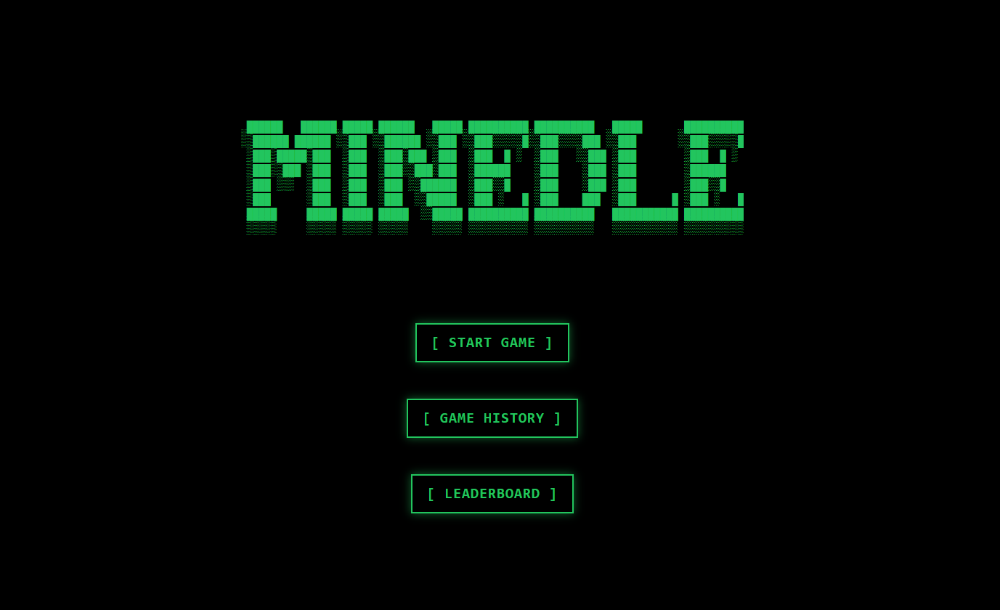
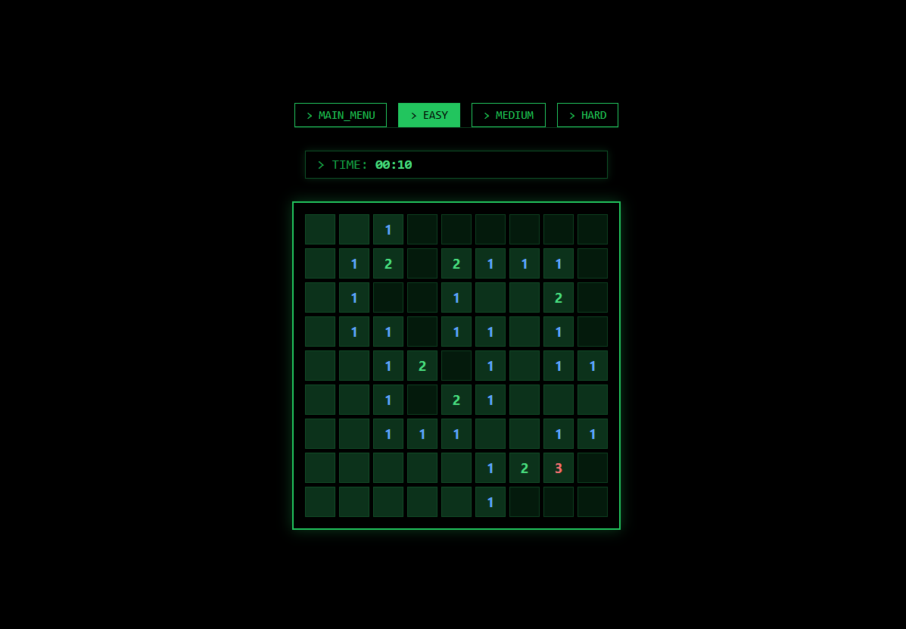
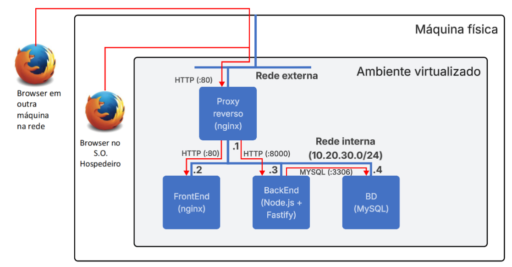

# Projeto de Computação em Nuvem: Minedle
## Feito por:
Felipe Pires Leonardi - 23013506  
Lucas Camargo Teixeira - 23011315  
Lucas Henrique Meng - 23003677  

## Objetivos da aplicação
Um site de campo minado, onde cada dia um novo campo diferente será gerado, com sistema de placar do dia, histórico dos últimos tabuleiros para jogar e histórico do jogador.

## Componentes por VM

### VM 1 - Proxy reverso
- Tecnologia escolhida: Nginx.
- Função: Único ponto de entrada da aplicação, possui duas placas de redes: Uma para rede virtual externa e outra de rede virtual interna, responsável pelo proxy/roteamento do tráfego de serviços para o Frontend e Backend.

### VM 2 - Frontend
- Tecnologia escolhida: Nginx para gerenciar os arquivos estáticos do serviço web (html, css, js).
- Função: Onde se hospeda a interface da aplicação e a lógica geral do campo minado.

### VM 3 - Backend
- Tecnologia escolhida: Node.js com o framework Fastify.
- Função: Comunicação com o Banco de Dados, geração dos tabuleiros, gerenciamento das autenticações e permissões (login).
### VM 4 - Banco de dados
- Tecnologia escolhida: MySQL.
- Função: Armazenar dados da aplicação.
##Plano de endereçamento IP

| VM | Tipo de Rede | IP | Portas |
|:---|:---|:---|:---|
| Proxy Reverso | Rede Externa | IP dinâmico/estático local | 80 (http) |
| Proxy Reverso | Rede Interna | 10.20.30.1/24 | - |
| Frontend | Rede Interna | 10.20.30.2/24 | 80 (http) |
| Backend | Rede Interna | 10.20.30.3/24 | 8000 (http) |
| BD | Rede Interna | 10.20.30.4/24 | 3306 (MySQL) |

A sub-rede privada 10.20.30.0/24 garante que as máquinas do Frontend (10.20.30.2), Backend (10.20.30.3) e Banco de Dados (10.20.30.4) fiquem inacessíveis por redes exteriores. O Proxy Reverso (10.20.30.1) atua como gateway, responsável por policiar todo o tráfego que entra e sai da rede.
## Fluxos de comunicação entre os componentes, informando portas, protocolos, tipos de transações
### Client → Proxy reverso (10.20.30.1:80)
O tráfego ocorre via protocolo HTTP (TCP) na porta 80. O Proxy recebe uma requisição do usuário, e de maneira segura, decide para qual máquina interna a requisição deve ser encaminhada.
### Proxy reverso → Frontend (10.20.30.2:80)
Ocorre via protocolo HTTP (TCP), na porta padrão 80. Consiste em transações de requisição de arquivos. O Proxy solicita a página web e o Frontend devolve os arquivos da interface da aplicação.
### Proxy reverso → Backend(10.20.30.3:8000)
O tráfego ocorre via protocolo HTTP (TCP), na porta 8000. São transações de chamada de API, para executar as rotas, como enviar o tempo do usuário para o banco de dados, por exemplo.
### Backend → Banco Dados(10.20.30.4:3306)
Utiliza o protocolo padrão do MySQL (TCP), na porta 3306. As transações são consultas a banco de dados executadas pelo Node.js para gravar ou recuperar informações, como o placar de jogadores, por exemplo.

## Linguagens e frameworks de implementação
- Frontend: HTML, CSS, JavaScript, servidos via NGINX.
- Backend: Node.js com o framework Fastify.
- Banco de Dados: MySQL.
- Servidor de Borda / Firewall Proxy: NGINX.

